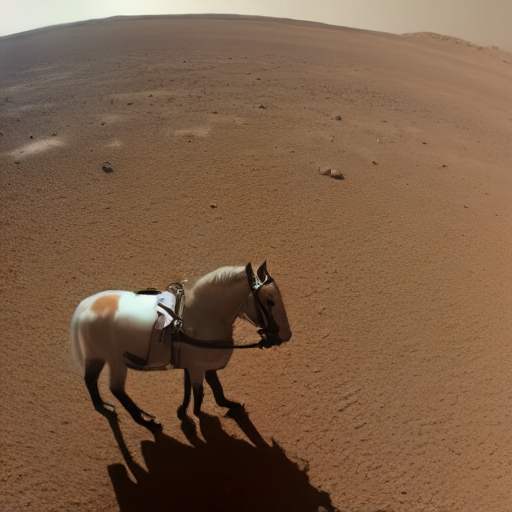

# test：模型在真卡上运行的结果与一个简单示例

## 简单示例（一条命令）

把一张 512² 合成测试图的 latent，送进 **TAESD 解码器**，得到一张图，再和两份独立参照比。
TAESD 是 SD1.5 的轻量 VAE 解码器：35 个卷积、3 次上采样、1 次 tanh，整个编成一个设备程序，一次 `dort calbin run` 跑完。

```bash
cd <CALCULET_HOME>/sd15-npu && source ../env.sh        # 先照 README「在一台新机器上复现」跑过 tools/bootstrap.sh

# 有真卡（确认这块卡现在可以用）：先只读查卡，满足才跑
SD15NPU_ALLOW_BOARD=1 SD15NPU_BOARD_LOCK=<现场的板锁文件> bash test/run_example.sh
# 再加一遍 ComfyUI 原生工作流（提示词 ⇒ 出图，解码走 NPU）
SD15NPU_ALLOW_BOARD=1 SD15NPU_BOARD_LOCK=<现场的板锁文件> bash test/run_example.sh --comfy

# 没有卡：同一个设备程序在 CPU 上重放（npu-sim，只查接线，不是 NPU 的数）
bash test/run_example.sh

# 解码器换成正式 VAE（分段程序，画质同 ComfyUI 自带的 VAEDecode）：上面每条命令后面加 --vae，例如
SD15NPU_ALLOW_BOARD=1 SD15NPU_BOARD_LOCK=<现场的板锁文件> bash test/run_example.sh --vae --comfy
```

各种情况下会看到什么：

- **真卡跑通**：屏幕上打出 `✓ TAESD 上板（真机实测）：3 次逐字节一致；对 bf16 参照余弦 0.999999、PSNR 60.3 dB，对 fp32 PSNR 55.9 dB；…`。
  图在 `out/taesd-board/image/board.png`，和下面的 `results/npu3-20261114/taesd_image/board.png` 应该一样。
- **卡不满足条件**：比如板上不是 DeviceRT（dort 报「拒」）、或者别人正在用，脚本只读查完就停，不往卡上发任何作业。
- **没有卡**：打出 `image：sim 对 bf16 参照 余弦 0.999999 … PSNR 60.6 dB；对 fp32 … 55.9 dB`。

板锁文件按现场规矩给：npu3 上用的是 `/opt/data/locks/board-0000:07:00.0.lock`；不设 `SD15NPU_BOARD_LOCK` 时，用的是 dort 的缺省 `/opt/data/locks/board.lock`。
挂死就停、找管卡的人：⛔ kill 在飞的 dort、⛔ 复位、⛔ 刷写。

**复现过**：2026-11-14 在 npu3 上，从 GitHub 匿名克隆到一个全新目录，`bootstrap.sh` 之后跑 `run_example.sh --comfy`，真卡上出的三张图（TAESD、ComfyUI 的 NPU 解码与 CPU 对照）和下面存的逐字节相同。

完整的上板检查是一条命令：`SD15NPU_ALLOW_BOARD=1 SD15NPU_BOARD_LOCK=… $CALCULET_HOME/venv/bin/python -I tools/board_check.py --comfy`。
它依次重出 calbin、静态核对、只读查卡、跑 7 个单 kernel、跑整个解码器、跑 ComfyUI，任何一步不对就停。下面的结果就是它跑出来的。

## 真机实测结果（2026-11-14，npu3，`/dev/calculet0`，PCI 0000:07:00.0）

性能单独整理在 [`PERF.md`](PERF.md)：TAESD 整次中位数 0.113 s（15 遍、0.111–0.115 s），比同机 CPU fp32 快约 1.6 倍；ComfyUI 整条约 50 s，其中 NPU 只有 0.12 s。

环境：Linux x86_64；calculet 工具链 rustc 1.98.1、docc 0.4.1、dort 0.4.1；板上是 DRT rt 3.1 / ABI 1.1，2 个芯粒，
`dort device` 的原样输出见 `results/npu3-20261114/dort_device.txt`。
命令是 `board_check.py --comfy`，6 步全过、退出 0，用时约 1.5 分钟（`results/npu3-20261114/board_summary.json`）。

### 1. TAESD 整个解码器（latent = 合成测试图经 TAESD 编码器）

| 项 | 结果 |
| --- | --- |
| 确定性 | 整次跑 3 遍，输出逐字节一致 |
| 对 bf16 口径的 torch 参照 | 余弦 0.9999987、PSNR 60.3 dB、最大差 0.0156（numpy 模拟是 60.6 dB） |
| 对 diffusers fp32 | 余弦 0.9999967、PSNR 55.9 dB |
| 只部署（参数块 2.6 MB） | 0.003 s（`dort --deploy-only` 的墙钟） |
| 整次（写 0.3 MB ⇒ 跑 ⇒ 读回 17 MB） | 0.111 / 0.112 / 0.112 s ⇒ 推理约 0.11 s（整次中位数减只部署，是估算） |

| 原图（合成） | NPU 解码（真卡） | diffusers fp32 参照 |
| --- | --- | --- |
|  |  |  |

TAESD 本身是有损的：同一张图编码再解码，fp32 也只有 27.3 dB。NPU 和 fp32 参照之间的差（55.9 dB）比这小得多。

另外三组 latent 也在真卡上跑了（`tools/taesd.py board --latent <K> --runs 3`，结果在 `results/npu3-20261114/taesd_latents/`）：

| latent | 逐字节一致（3 遍） | 对 bf16 参照 余弦 / PSNR | 对 fp32 PSNR | numpy 模拟（对照） | 整次墙钟 |
| --- | --- | --- | --- | --- | --- |
| image（上表） | ✓ | 0.9999987 / 60.3 dB | 55.9 dB | 60.6 / 55.9 dB | 0.111 s |
| randn:0（标准正态） | ✓ | 0.9999903 / 52.7 dB | 46.8 dB | 52.7 / 46.8 dB | 0.114 s |
| zeros | ✓ | 0.9999993 / 65.8 dB | 59.4 dB | 67.3 / 59.4 dB | 0.112 s |
| big（±8，过 tanh 饱和段） | ✓ | 0.9999943 / 56.1 dB | 50.7 dB | 56.2 / 50.7 dB | 0.114 s |

### 2. ComfyUI 原生工作流（解码在 NPU 上）

工作流 `comfy/workflows/sd15_taesd_npu.api.json` 依次是：DiffusersLoader → CLIPTextEncode（"a photo of an astronaut riding a horse on mars"）
→ KSampler（euler，20 步，cfg 7.5，seed 42）→ **SD15 NPU · TAESD Decode（backend = npu）** → SaveImage。旁边另接一路 ComfyUI 自带的 VAEDecode 作对照。

| SD15 NPU · TAESD Decode（真卡） | ComfyUI 自带 VAEDecode（CPU，正式 VAE） |
| --- | --- |
|  |  |

- 节点日志（`comfyui/node_log.txt`）是「TAESD 解码 第 1/1 张：backend=npu，0.12 s，dort 墙钟 0.113 s」，没有落回 CPU。
- 整条工作流 50.1 s，服务起来另用 4.0 s。大头是 CLIP 和 UNet 采样，**现在还在 CPU 上**（README「NPU / CPU 分工」）。
- 两张图的差别（PSNR 29.9 dB）来自 TAESD 本身比正式 VAE 粗；正式 VAE 上 NPU 是下一步（PROGRESS「B1b」）。

### 2b. 正式 VAE 解码器（分段程序，画质同 ComfyUI 自带的 VAEDecode）

2026-11-14 17:22 在同一块卡上跑（`board_check.py --no-build --tests "" --no-taesd --vae --comfy`，结果在 `results/npu3-20261114/vae/`）：

- **正确性**：3 遍逐字节一致；对 bf16 口径的 torch 参照余弦 0.999998、PSNR 58.3 dB，对 diffusers fp32 56.9 dB（latent 是合成测试图经 VAE 编码器）。
- **ComfyUI**：同一份工作流把解码换成 **SD15 NPU · VAE Decode**（`comfy/workflows/sd15_vae_npu.api.json`），
  出的图和旁边 ComfyUI 自带 VAEDecode（CPU）出的相比 **55.6 dB、最大差 5/255**。
- **时间**：第一版 6 段合计 5.18 s（节点 5.89 s）；按真卡逐 kernel 计时优化后 **0.98 s（节点 0.99 s），比同机 CPU fp32（1.71 s）快约 1.75 倍**，见 [`PERF.md`](PERF.md) 与 `results/npu3-20261114/vae-opt/`。

| SD15 NPU · VAE Decode（真卡） | ComfyUI 自带 VAEDecode（CPU） | SD15 NPU · TAESD Decode（真卡，对照） |
| --- | --- | --- |
|  |  |  |

在真卡上跑正式 VAE：`SD15NPU_ALLOW_BOARD=1 SD15NPU_BOARD_LOCK=… $CALCULET_HOME/venv/bin/python -I tools/vae.py board`
（先 `tools/vae.py calbin` 出各段 calbin）；ComfyUI 里把 `comfy/workflows/sd15_vae_npu.api.json` 拖进去，backend 选 npu。

### 2c. SD1.5 UNet 一次前向（CFG 两路，20 段程序，第一版）

2026-11-14 在同一块卡上跑（`tools/unet.py board --t 500 --runs 2`，结果在 `results/npu3-20261114/unet/`）：

- **正确性**：2 遍逐字节一致；对 bf16 口径的 torch 参照 有提示词 49.8 dB、空提示词 50.1 dB（余弦 0.999995），对 diffusers fp32 49.4 / 48.0 dB。
- **时间**：一步（CFG 两路）第一版 12.35 s ⇒ 注意力换成本仓的 `flash_attn!` 8.19 s（`results/npu3-20261114/unet-attn/`）
  ⇒ 宽通道卷积改走 `linear!` 5.16 s（10 段，`results/npu3-20261114/unet-wide/`）⇒ 自注意力压成稠密 token **4.18 s**（`results/npu3-20261114/unet-dense/`），
  精度不变；还比同机 CPU fp32（约 2 s）慢，正在优化（见 [`PERF.md`](PERF.md) 1c）。
- 还没接进 ComfyUI 的采样循环（KSampler 里的 UNet 现在还在 CPU 上）。

在真卡上跑：`SD15NPU_ALLOW_BOARD=1 SD15NPU_BOARD_LOCK=… $CALCULET_HOME/venv/bin/python -I tools/unet.py board --t 500`（先 `tools/unet.py calbin` 出 20 段 calbin，约 2 分钟）；
没卡时 `tools/unet.py sim --t 500` 在 CPU 上重放同一份设备程序（不是 NPU 的数）。

### 3. 单 kernel（7 个 kernel、20 个用例：19 个必过，`tanh/tiny` 只记录）

明细在 `results/npu3-20261114/kernels.json`。期望值按 torch 语义另算，「ULP(max)」是以输出最大值的 bf16 ULP 为单位的最大差。

| 测试 | 查什么 | 逐位相同 | 最大差 ULP(max) | 余弦（最差） |
| --- | --- | --- | --- | --- |
| up_256 | 最近邻上采样，两核按 num_cores() 分行 | 100% | 0 | 1 |
| conv_in（4 例） | 卷积 + ReLU，Cin = 32 | ≥ 99.99% | 0.06 | 1.0000000 |
| convr_64（4 例） | 卷积 + 残差 + ReLU | ≥ 99.999% | 0.50 | 1.0000000 |
| conv_out | 512 宽的快路 | 99.99% | 0.50 | 1.0000000 |
| convr_512 | 512 宽 + 残差 | 99.999% | 1.00 | 1.0000000 |
| tanh（3 例） | VU 的 tanh 近似指令 | ≥ 99.999% | 0.00（最大差 2.4e-7） | 1.0000000 |
| temb（5 例） | 时间步嵌入（cos 近似指令） | 19–100% | 2.50 | 0.99996 |

时间步嵌入那一行：板上 `cos_approx` 的输出全部落在 1/128 的网格上，这是指令本身的分辨率，不是接线错（DESIGN F19）。
`tanh/tiny`（输入 1e-30 量级）板上整片出 0，不影响 SD。

## 目录

```text
test/
├── README.md                 本文
├── run_example.sh            简单示例（上面那条命令）
├── PERF.md                   真卡性能（口径、全表、CPU 对照）
└── results/npu3-20261114/    真卡那一次的原始结果（真机实测）
    ├── board_summary.json    board_check.py 每一步的结果与用时
    ├── dort_device.txt       只读查卡时 dort device 的原样输出
    ├── kernels.json          7 个单 kernel、20 个用例的比对结果
    ├── perf.json             性能的原始记录（PERF.md 的数都从这里来）
    ├── taesd_image/          TAESD 解码：metrics.json、dort.log、board.png（真卡出的图）、source.png、ref_fp32.png
    ├── taesd_latents/        另外三组 latent（randn-0、zeros、big）：各自的 metrics.json、board.png；run.log
    ├── vae/                  正式 VAE 第一版（6 段，5.18 s）：metrics.json、board.png、dort.log、board_summary.json；comfyui/（真卡出的图、CPU 对照、日志）
    ├── vae-opt/              正式 VAE 优化后（3 段，0.98 s）：同上，另有 prof/（优化前、卷积列块、NHWC GN 三份逐 kernel 计时）
    ├── unet/                 UNet 一次前向第一版（20 段，CFG 两路）：board_metrics.json（真卡）、sim_metrics.json（模拟）、
    │                         prof_kernels.json（逐 kernel 计时）、breakdown.json（一步的时间按 kernel / 段拆开）、prof_attention_k_transposed.json
    ├── unet-attn/            UNet 注意力优化后（18 段，8.19 s）：同上；flash_attn_single_kernel.md（单 kernel 上板与二分）
    ├── unet-wide/            UNet 宽通道卷积走 linear! 之后（10 段，5.16 s）：同上
    ├── unet-dense/           UNet 自注意力压成稠密 token 之后（10 段，4.18 s）：同上
    └── comfyui/              ComfyUI 工作流：run.json、node_log.txt、taesd_npu.png（真卡）、vae_cpu_ref.png（CPU 对照）
```

`board_summary.json`、`kernels.json`、`taesd_image/metrics.json` 里的 `tolerance` 是当时（首轮）的门槛。之后按这次实测收紧了，现在的门槛在 `ref/ktest.py` 和 `tools/taesd.py` 的 `BOARD_TOL`。
